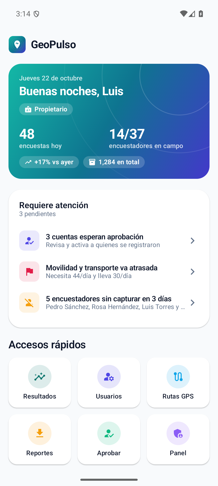
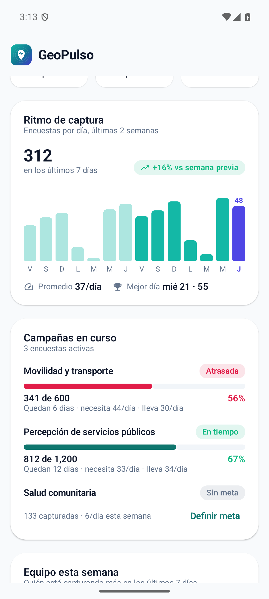
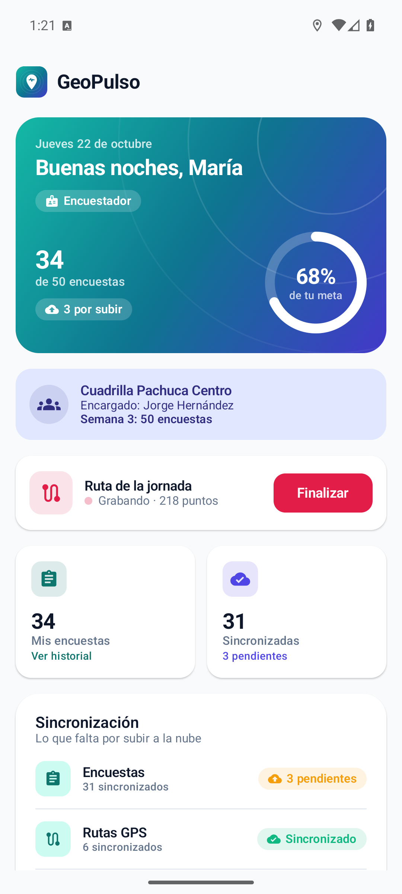
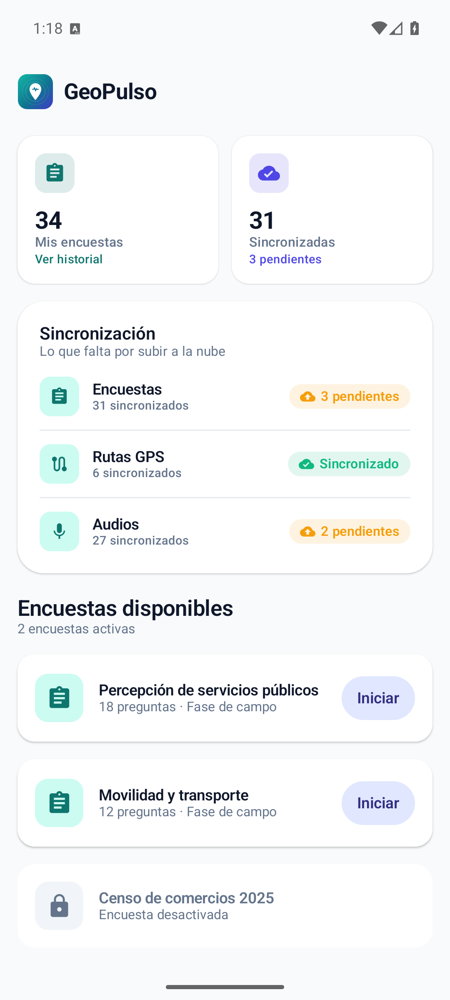
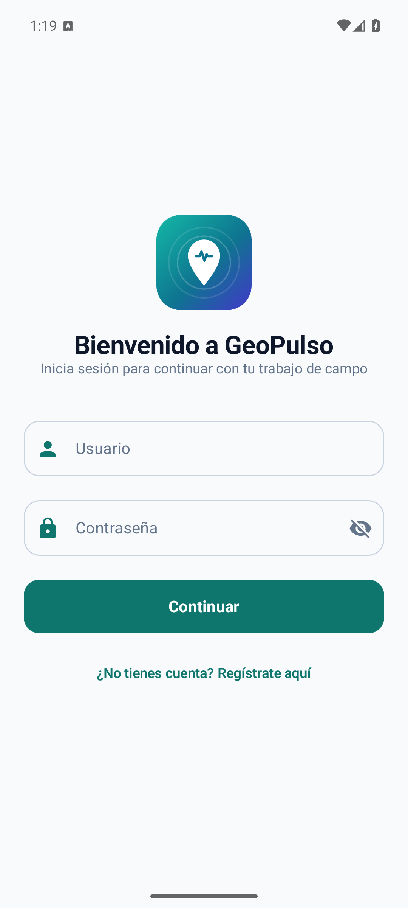
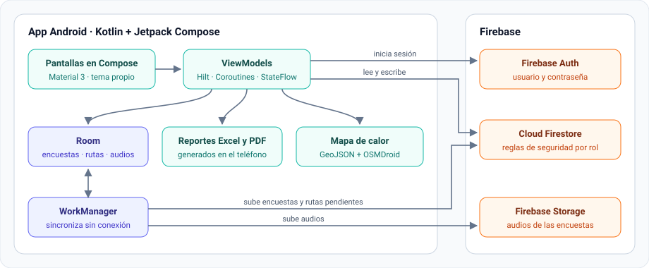

  

<h1 align="center">GeoPulso</h1>

  <b>Inteligencia territorial para equipos de encuestas en campo</b> 
  App Android para capturar encuestas casa por casa (con o sin internet), coordinar equipos y ver en tiempo real cómo avanza cada campaña en el mapa.

  
  
  
  
  
  

> [!NOTE]
> Este repositorio presenta el producto: qué hace, cómo se ve y cómo está construido. El código fuente es privado; si quieres verlo o probar una demo, contáctame desde [mi perfil](https://github.com/luis16112004).

## Capturas

| Panel de administración | Ritmo y campañas | Panel del encuestador | Encuestas del día | Inicio de sesión |
| --- | --- | --- | --- | --- |
|  |  |  |  |  |

## ¿Qué problema resuelve?

Los equipos que levantan encuestas en campo suelen trabajar con formularios en papel o apps genéricas, y la coordinación se hace por WhatsApp: nadie sabe con certeza cuántas encuestas van, dónde faltan o qué campaña va atrasada.

GeoPulso junta todo en una sola app con tres vistas según el rol:

### Administración

- **Panel operativo:** encuestas de hoy contra ayer y cuántos encuestadores están en campo en ese momento.
- **Requiere atención:** reúne lo pendiente de actuar:
  - Cuentas por aprobar.
  - Campañas atrasadas.
  - Encuestadores sin actividad.
- **Ritmo de captura:** encuestas por día de las últimas dos semanas, comparadas con la semana anterior.
- **Avance de campañas:** cada campaña contra su meta. Se marca **atrasada** cuando el ritmo que le hace falta supera el promedio real de los últimos 7 días.
- **Mapa territorial:** municipios, distritos federales, distritos locales y secciones electorales. Incluye:
  - Un mapa de calor por número de encuestas.
  - El porcentaje de cobertura.
  - Un ranking de zonas.
- **Resultados por pregunta:** gráficas con porcentajes y desglose de cada opción.
- **Reportes en dos pasos:** se descargan en Excel o en PDF con gráficas, listos para abrir o compartir.
- **Gestión de usuarios:** altas, aprobación de registros y roles con permisos.

### Encuestadores

- **Captura sin conexión:** la encuesta se guarda en el teléfono y se sincroniza sola cuando vuelve la señal.
- **Ruta GPS de la jornada:** se graba con ubicación y audio, que se piden juntos en un solo diálogo.
- **Su avance:**
  - Si tiene meta asignada, avance contra la meta.
  - Si no, cuántas encuestas lleva hoy y en total.
- **Estado de sincronización:** cuántas encuestas, rutas y audios faltan por subir.

### Responsables de sección

- **Su cuadrilla:** avance de cada integrante, metas e historial.
- **Detalle por encuestador:** encuestas por día y rutas recorridas en el mapa.

### Módulo web complementario

- **Red de promotores:** los promotores registran a sus simpatizantes ("promovidos") y los capturistas dan seguimiento a sus solicitudes. Los permisos dependen del rol de cada quien. Esta vitrina no incluye datos personales.

## Cómo está construida

  

## Decisiones técnicas

- **Funciona primero sin conexión.** Cada captura se guarda en Room y un `SyncWorker` de WorkManager la sube después, con reintentos y sin bloquear al encuestador.
- **Reportes sin servidor.** El archivo Excel (`.xlsx`) se arma a mano como un ZIP con su XML, y el PDF se dibuja con `PdfDocument`. Ninguno de los dos depende de un backend.
- **Mapa de calor real.** Cada encuesta se ubica en su municipio, distrito o sección con un algoritmo de *point-in-polygon* sobre los GeoJSON electorales de Hidalgo. Antes se descarta lo que cae fuera de la caja de cada zona y el cálculo corre en segundo plano.
- **Consultas que escalan.** Los totales se piden como conteos al servidor (`count()`), y el panel descarga solo los registros de los últimos 30 días.
- **Seguridad por rol.** Las reglas de Firestore validan quién puede crear, aprobar o editar a quién. El auto-registro siempre nace inactivo, y nadie puede cambiar su propio rol ni sus permisos.
- **Errores entendibles.** Las excepciones de Firebase y de red se traducen a mensajes claros en español. El detalle técnico se conserva en el log para diagnosticar.
- **Diseño propio.** Paleta, tipografía y componentes reutilizables: tarjetas, indicadores, anillos de progreso y gráficas dibujadas en Canvas.

## Tecnologías

| Área | Herramientas |
| --- | --- |
| Lenguaje e interfaz | Kotlin, Jetpack Compose, Material 3 |
| Arquitectura | MVVM, Hilt, Coroutines y Flow |
| Datos en el teléfono | Room, DataStore, WorkManager |
| Nube | Firebase Auth, Cloud Firestore, Storage, Cloud Messaging |
| Mapas | OSMDroid (OpenStreetMap) y GeoJSON |
| Calidad | Pruebas unitarias con JUnit, R8/ProGuard para release |

## Autor

**Luis David Casillas Gutiérrez** · [@luis16112004](https://github.com/luis16112004)
